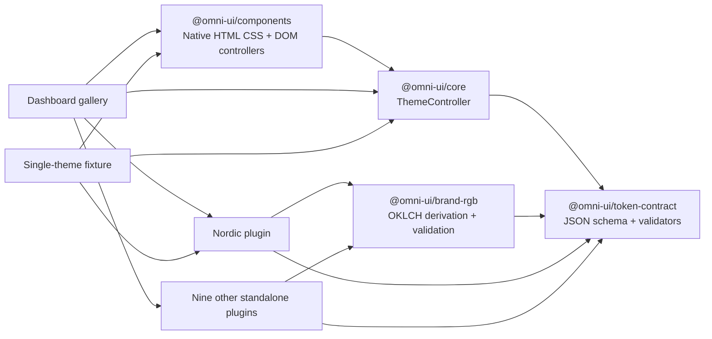

# Architecture

## Package dependency direction



Core and components never import the theme catalog. Themes do not import one another, core, or components. Shared brand derivation lives in `@omni-ui/brand-rgb`; theme loaders compose it with their base values before returning the standard validated definition. A new package is registered by the consuming application, without edits to core or component source.

The renderer is ordinary HTML. `packages/components/src/styles.css` scopes every selector to `[data-om-theme-root]`; `DialogController`, `TableController`, and `createNavigation` add behavior to caller-owned DOM. There is no virtual DOM, component runtime, custom-element registry, or required application framework.

## Theme-loading flow

```mermaid
sequenceDiagram
  participant App
  participant Controller
  participant Plugin
  participant Validator
  participant Root as Designated DOM root
  App->>Controller: setTheme(themeId)
  Controller->>Controller: Increment request generation
  Controller->>Plugin: load() (lazy chunk)
  Plugin->>Validator: light + dark token maps
  Validator->>Validator: Require every contract token
  alt stale request
    Controller-->>App: Ignore result
  else invalid or failed
    Controller-->>App: Reject with actionable error
    Controller->>Root: Preserve last successful theme
  else current and valid
    Controller->>Root: Swap one scoped style + attributes atomically
    Controller->>App: ready state; persist preference
  end
```

Theme identity and mode are separate:

- `themeId` selects the visual package.
- `modePreference` is `light`, `dark`, or `system`.
- `resolvedMode` is `light` or `dark`, using `matchMedia` only for `system`.

Changing mode applies an already loaded appearance synchronously. System listeners react only while system preference is active. `destroy()` removes media and storage listeners and invalidates pending loads.

## Scoped runtime interface

The controller owns one style element containing:

```css
[data-om-theme-root][data-om-theme="minimalist-nordic"] {
  --color-page-bg: #f3f6f7;
  /* every other resolved semantic token */
}
```

It also sets `data-om-theme`, `data-om-mode`, and inline `color-scheme` on the caller's root. One controller has one active style and one root, preventing overlapping theme rules. Variables inherit into ordinary descendants. Applications needing independent themes can use separate controllers and nested roots.

## Persistence and tabs

`om.theme-preferences.v1` stores `{ themeId, modePreference }`. Stored JSON, IDs, and enum values are validated. Storage access is wrapped because browsers can expose `localStorage` while throwing on reads or writes. Supported `storage` events update other tabs. Invalid remote values are ignored with an exposed error. Demo tasks use the separate `om.demo-tasks.v1` key.

## Failure policy

Registration fails immediately for duplicate IDs, malformed IDs, missing manifest fields, incompatible contract majors, or incomplete mode support. Loading fails without changing the active DOM identity. `status: 'error'` and `error` describe the failure. There is no fallback theme substitution. The only initial default is the consumer's explicit `initialThemeId` when no valid preference exists.

## Distribution

Each theme's `load()` dynamically imports `tokens.ts`. A single-theme consumer has only that package in its module graph. The gallery imports ten manifests eagerly and ten token modules lazily; all ten chunks exist in its deployment, while unselected chunks stay out of the browser's initial load. Bundle claims are verified by inspecting actual fixture artifacts, not inferred from source structure.
